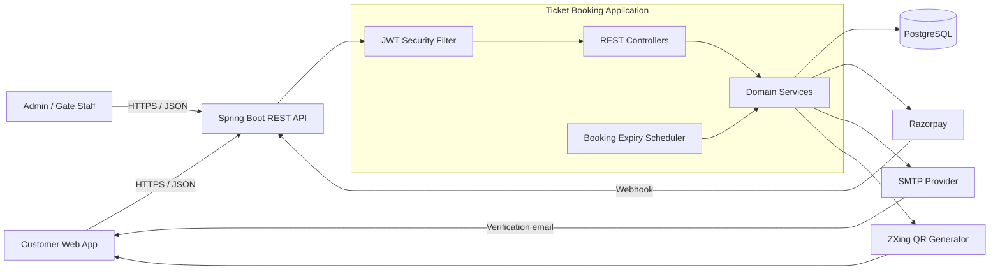
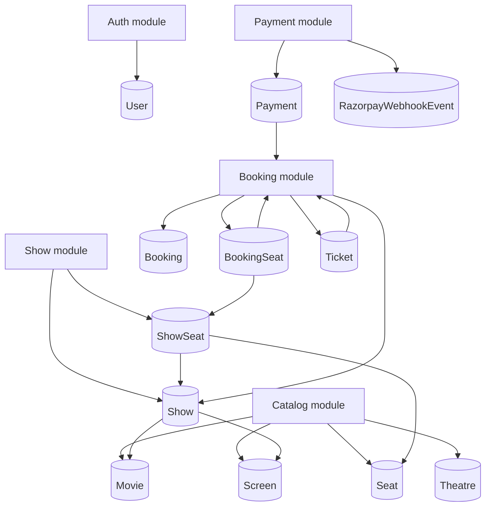
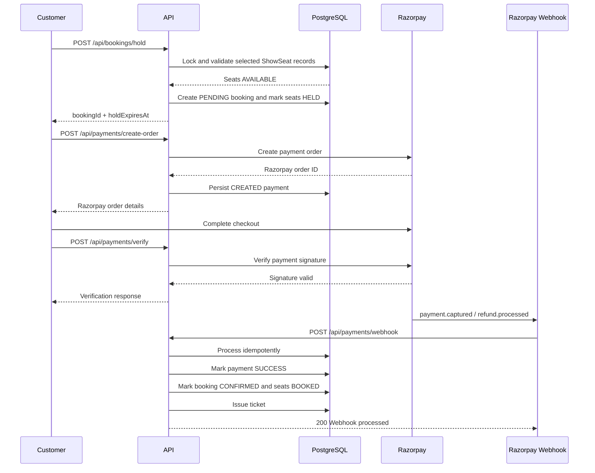
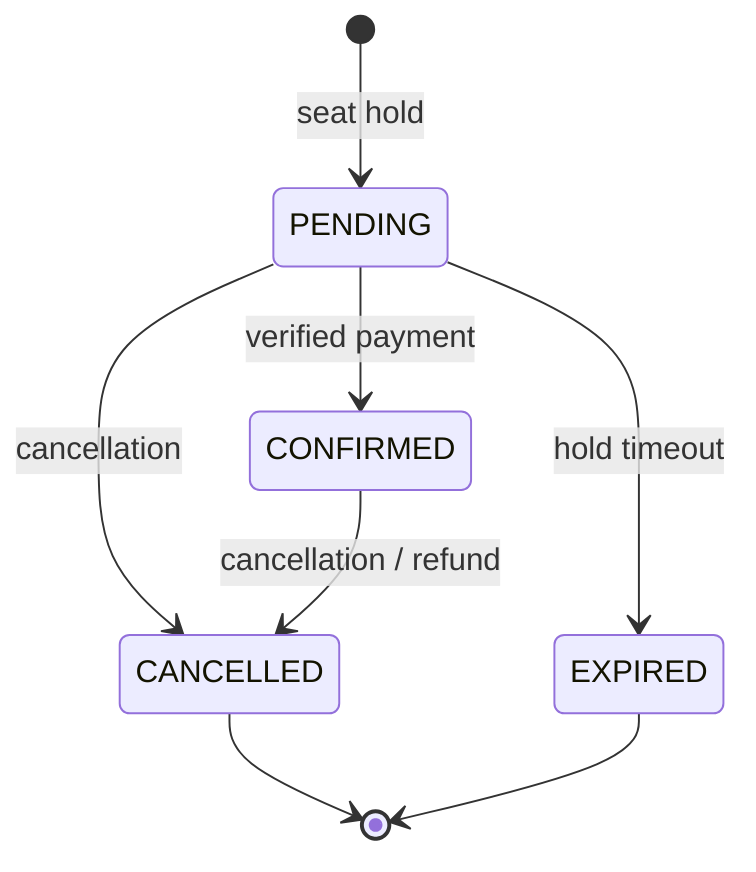
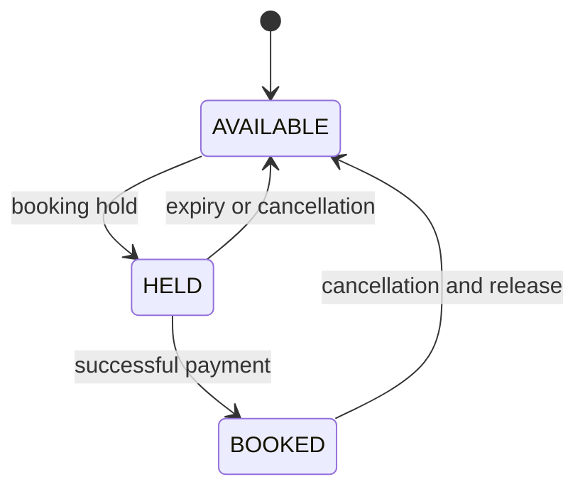
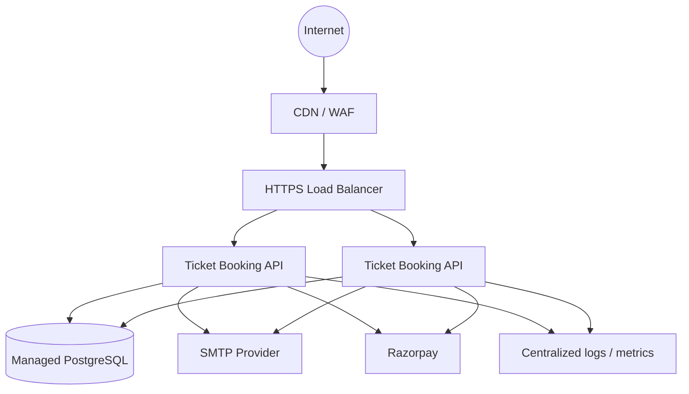

# Ticket Booking System

Production-oriented backend for cinema ticket discovery, seat inventory, booking, payment, refunds, and ticket validation.

The service is implemented as a stateless Spring Boot REST API. It uses PostgreSQL for transactional data, JWT for authentication, Razorpay for payment processing, SMTP for email verification, and ZXing for ticket QR-code generation.

> **Status:** Active development. The API is functional, but deployment hardening and operational infrastructure should be completed before using it for real customer payments.

## Contents

- [Product capabilities](#product-capabilities)
- [Architecture](#architecture)
- [Booking lifecycle](#booking-lifecycle)
- [Domain model](#domain-model)
- [Technology stack](#technology-stack)
- [Repository structure](#repository-structure)
- [Prerequisites](#prerequisites)
- [Configuration](#configuration)
- [Run locally](#run-locally)
- [API reference](#api-reference)
- [Authentication](#authentication)
- [Payment integration](#payment-integration)
- [Error handling](#error-handling)
- [Testing](#testing)
- [Production deployment](#production-deployment)
- [Security checklist](#security-checklist)
- [Observability and operations](#observability-and-operations)
- [Roadmap](#roadmap)
- [Contributing](#contributing)

## Product capabilities

### Customer experience

- Register with email and password.
- Verify an account through an email verification link.
- Log in and receive a JWT bearer token.
- Browse movies, theatres, screens, shows, and seat layouts without authentication.
- Search and filter movies by title, language, and genre.
- Search and filter theatres by city and name.
- Select seats for a show and place a temporary five-minute hold.
- Create a Razorpay order and verify a completed payment.
- View booking history and ticket details.
- Retrieve a ticket QR code for entry.
- Cancel eligible bookings and initiate a refund workflow.

### Admin experience

- Manage movies, theatres, screens, seats, and shows.
- Initialize show-specific seat inventory.
- Manually confirm a booking when required.
- Cancel scheduled shows.
- Validate tickets at the cinema gate.

### Platform capabilities

- Stateless JWT authentication with BCrypt password hashing.
- Role-based access control for administrative operations.
- Transactional seat-state transitions.
- Scheduled cleanup of expired seat holds.
- Razorpay payment signature verification.
- Razorpay webhook processing with persisted event identifiers.
- Refund tracking.
- Consistent JSON error responses.
- Actuator endpoints for health and operational metrics.

## Architecture

The application is a modular monolith. This keeps booking and payment state transitions within one transactional boundary while allowing the domain modules to be extracted or scaled independently later.



### Request path

1. The client sends an HTTP request to the API.
2. The JWT filter authenticates bearer tokens when present.
3. Spring Security applies public, authenticated, and admin-only rules.
4. A controller validates input and delegates to a domain service.
5. Services coordinate repositories and external integrations.
6. PostgreSQL stores the authoritative booking, seat, payment, and ticket state.

### Module architecture



## Booking lifecycle

Seat inventory is tracked per show rather than only per physical seat. This allows the same theatre seat to be sold independently for different show times.



### State machines





The scheduled expiry component runs cleanup for expired holds. Payment webhooks are the source of truth for asynchronous payment outcomes and may issue a ticket after a successful capture.

## Domain model

| Entity | Purpose | Important relationships |
|---|---|---|
| `User` | Customer or administrator identity | Owns bookings |
| `VerificationToken` | Email verification token and expiry | Belongs to a user |
| `Movie` | Movie metadata and discovery fields | Has many shows |
| `Theatre` | Venue information | Has many screens |
| `Screen` | Auditorium within a theatre | Has physical seats and shows |
| `Seat` | Physical seat definition | Belongs to a screen |
| `Show` | Movie screening at a screen and time | Has show-specific seats |
| `ShowSeat` | Sellable seat inventory for one show | Tracks `AVAILABLE`, `HELD`, or `BOOKED` |
| `Booking` | Customer reservation and amount | Contains booking seats and payment |
| `BookingSeat` | Seat snapshot attached to a booking | Stores price at booking time |
| `Payment` | Razorpay order, payment, and refund state | Belongs to a booking |
| `RazorpayWebhookEvent` | Received webhook event identity | Supports duplicate-event protection |
| `Ticket` | Issued admission ticket | Contains ticket code and usage state |

### Enumerations

- **Roles:** `ROLE_CUSTOMER`, `ROLE_ADMIN`
- **Seat types:** `REGULAR`, `PREMIUM`, `RECLINER`
- **Booking statuses:** `PENDING`, `CONFIRMED`, `CANCELLED`, `EXPIRED`
- **Show-seat statuses:** `AVAILABLE`, `HELD`, `BOOKED`
- **Payment statuses:** `CREATED`, `SUCCESS`, `FAILED`, `REFUND_PENDING`, `REFUNDED`
- **Refund statuses:** `NOT_REQUIRED`, `PENDING`, `PROCESSED`, `FAILED`
- **Show statuses:** `SCHEDULED`, `CANCELLED`, `COMPLETED`

## Technology stack

| Layer | Technology |
|---|---|
| Language | Java 17 |
| Framework | Spring Boot 4.1.2 |
| Web | Spring MVC |
| Persistence | Spring Data JPA / Hibernate |
| Database | PostgreSQL |
| Security | Spring Security, JWT (`jjwt`), BCrypt |
| Payments | Razorpay Java SDK |
| Email | Spring Mail / SMTP |
| QR codes | ZXing |
| Operations | Spring Boot Actuator |
| Build | Maven Wrapper |

## Repository structure

```text
src/
├── main/java/com/abhinav/ticketbooking/
│   ├── config/              # Security and Razorpay configuration
│   ├── controller/          # HTTP API endpoints
│   ├── dto/                 # Request and response contracts
│   ├── entity/              # JPA entities and domain enums
│   ├── exception/            # Domain exceptions and JSON error handler
│   ├── repository/           # Spring Data repositories
│   ├── security/             # JWT filter, service, and user details
│   └── service/              # Auth, catalog, show, booking, payment, refund
├── main/resources/
│   └── application.properties
└── test/
    └── ...                  # Spring Boot test sources
```

## Prerequisites

- JDK 17+
- PostgreSQL 13+
- Git
- A Razorpay test account for payment flows
- An SMTP account for email verification (optional for non-email development)

Check the installed versions:

```bash
java -version
./mvnw -version
psql --version
```

## Configuration

The application reads configuration from environment variables, with development fallbacks defined in `application.properties`.

Create a database:

```sql
CREATE DATABASE ticket_booking;
```

Set environment variables before starting the application:

```bash
export DB_URL="jdbc:postgresql://localhost:5432/ticket_booking"
export DB_USERNAME="postgres"
export DB_PASSWORD="change-me"

export JWT_SECRET="replace-with-a-long-random-secret"
export JWT_EXPIRATION_MS="86400000"

export RAZORPAY_KEY_ID="rzp_test_your_key"
export RAZORPAY_KEY_SECRET="your-test-secret"
export RAZORPAY_WEBHOOK_SECRET="your-webhook-secret"

export MAIL_HOST="smtp.gmail.com"
export MAIL_PORT="587"
export MAIL_USERNAME="your-mailbox@example.com"
export MAIL_PASSWORD="your-smtp-password"

export FRONTEND_URL="http://localhost:5173"
```

### Configuration reference

| Variable | Required | Description |
|---|---:|---|
| `DB_URL` | Yes | JDBC PostgreSQL connection URL |
| `DB_USERNAME` | Yes | Database username |
| `DB_PASSWORD` | Yes | Database password |
| `JWT_SECRET` | Yes | Long, random signing key |
| `JWT_EXPIRATION_MS` | No | JWT lifetime in milliseconds |
| `RAZORPAY_KEY_ID` | Yes for payments | Razorpay public key |
| `RAZORPAY_KEY_SECRET` | Yes for payments | Razorpay private key |
| `RAZORPAY_WEBHOOK_SECRET` | Yes for webhooks | Webhook signature secret |
| `MAIL_HOST` | Yes for email | SMTP hostname |
| `MAIL_PORT` | No | SMTP port, normally `587` |
| `MAIL_USERNAME` | Yes for email | SMTP username |
| `MAIL_PASSWORD` | Yes for email | SMTP password or app password |
| `FRONTEND_URL` | Yes in deployment | Allowed frontend origin and verification-link base |

> **Security:** Never use repository defaults, test credentials, or shared secrets in production. Rotate any credentials that have ever been committed to a repository, shell history, CI log, or screenshot. Use a secret manager in deployed environments.

## Run locally

Clone and start the API:

```bash
git clone https://github.com/Iamabhipandat/ticket-booking-system.git
cd ticket-booking-system

./mvnw clean test
./mvnw spring-boot:run
```

The API starts on `http://localhost:8080`.

Useful operational endpoints:

```bash
curl http://localhost:8080/actuator/health
curl http://localhost:8080/actuator/info
```

Build an executable JAR:

```bash
./mvnw clean package
java -jar target/ticket-booking-0.0.1-SNAPSHOT.jar
```

## API reference

The default base URL is `http://localhost:8080`. All JSON endpoints use `Content-Type: application/json` unless noted otherwise.

### Authentication

| Method | Endpoint | Auth | Description |
|---|---|---|---|
| `POST` | `/api/auth/register` | Public | Register a customer |
| `POST` | `/api/auth/login` | Public | Authenticate and receive JWT |
| `GET` | `/api/auth/verify-email?token={token}` | Public | Verify email |
| `POST` | `/api/auth/resend-verification?email={email}` | Public | Resend verification email |
| `GET` | `/api/auth/me` | Bearer JWT | Get current user |

Register:

```bash
curl -X POST http://localhost:8080/api/auth/register \
  -H 'Content-Type: application/json' \
  -d '{
    "name": "Ada Lovelace",
    "email": "ada@example.com",
    "password": "correct-horse-battery-staple"
  }'
```

Login:

```bash
curl -X POST http://localhost:8080/api/auth/login \
  -H 'Content-Type: application/json' \
  -d '{"email":"ada@example.com","password":"correct-horse-battery-staple"}'
```

Use the returned token on protected requests:

```bash
curl http://localhost:8080/api/bookings/my-bookings \
  -H "Authorization: Bearer ${JWT_TOKEN}"
```

### Movies

| Method | Endpoint | Auth | Description |
|---|---|---|---|
| `GET` | `/api/movies` | Public | List movies |
| `GET` | `/api/movies/{id}` | Public | Get a movie |
| `GET` | `/api/movies/search?title={title}` | Public | Search by title |
| `GET` | `/api/movies/language/{language}` | Public | Filter by language |
| `GET` | `/api/movies/genre/{genre}` | Public | Filter by genre |
| `GET` | `/api/movies/filter?language={language}&genre={genre}` | Public | Filter by language and genre |
| `POST` | `/api/movies` | Admin | Create a movie |
| `DELETE` | `/api/movies/{id}` | Admin | Delete a movie |

### Theatres, screens, and seats

| Method | Endpoint | Auth | Description |
|---|---|---|---|
| `GET` | `/api/theatres/{id}` | Public | Get a theatre |
| `GET` | `/api/theatres/city/{city}` | Public | List theatres in a city |
| `GET` | `/api/theatres/search?name={name}` | Public | Search theatres |
| `GET` | `/api/theatres/filter?city={city}&name={name}` | Public | Filter theatres |
| `POST` | `/api/theatres` | Admin | Create a theatre |
| `GET` | `/api/screens/theatre/{theatreId}` | Public | List theatre screens |
| `GET` | `/api/screens/{id}` | Public | Get a screen |
| `POST` | `/api/screens/theatre/{theatreId}` | Admin | Create a screen |
| `PUT` | `/api/screens/{id}` | Admin | Update a screen |
| `DELETE` | `/api/screens/{id}` | Admin | Delete a screen |
| `GET` | `/api/seats/screen/{screenId}` | Public | List screen seats |
| `GET` | `/api/seats/screen/{screenId}/row/{rowName}` | Public | List seats in a row |
| `GET` | `/api/seats/{id}` | Public | Get a seat |
| `POST` | `/api/seats/screen/{screenId}` | Admin | Create a seat |
| `DELETE` | `/api/seats/{id}` | Admin | Delete a seat |

### Shows and show seats

| Method | Endpoint | Auth | Description |
|---|---|---|---|
| `GET` | `/api/shows/{id}` | Public | Get show details |
| `GET` | `/api/shows/screen/{screenId}` | Public | List shows for a screen |
| `GET` | `/api/shows/movie/{movieId}` | Public | List shows for a movie |
| `GET` | `/api/shows/movie/{movieId}/date?date=2026-11-02` | Public | List shows for a date |
| `POST` | `/api/shows/movie/{movieId}/screen/{screenId}` | Admin | Schedule a show |
| `PATCH` | `/api/shows/{id}/cancel` | Admin | Cancel a show |
| `POST` | `/api/show-seats/initialize/{showId}` | Admin | Create show-seat inventory |
| `GET` | `/api/show-seats/show/{showId}` | Public | List all show seats |
| `GET` | `/api/show-seats/show/{showId}/available` | Public | List available seats |
| `GET` | `/api/show-seats/show/{showId}/layout` | Public | Return seats grouped by row |

Create a show with a `LocalDateTime` payload:

```json
{
  "startTime": "2026-11-02T18:30:00",
  "endTime": "2026-11-02T21:00:00",
  "ticketPrice": 350.00
}
```

After creating a show, an admin must initialize its show-specific seat inventory before customers can select seats.

### Bookings

| Method | Endpoint | Auth | Description |
|---|---|---|---|
| `POST` | `/api/bookings/hold` | Bearer JWT | Hold seats for five minutes |
| `GET` | `/api/bookings/{bookingId}` | Bearer JWT | Get booking details |
| `GET` | `/api/bookings/my-bookings` | Bearer JWT | Get current user's history |
| `GET` | `/api/bookings/customer/{customerEmail}` | Authenticated | Get a customer's history |
| `POST` | `/api/bookings/{bookingId}/cancel` | Bearer JWT | Cancel a booking |
| `POST` | `/api/bookings/{bookingId}/confirm` | Admin | Manually confirm a booking |

Hold seats:

```bash
curl -X POST http://localhost:8080/api/bookings/hold \
  -H "Authorization: Bearer ${JWT_TOKEN}" \
  -H 'Content-Type: application/json' \
  -d '{
    "showId": 42,
    "showSeatIds": [101, 102],
    "customerEmail": "ada@example.com"
  }'
```

The response contains the booking ID, selected show-seat IDs, total amount, current status, creation time, and `holdExpiresAt`.

### Payments

| Method | Endpoint | Auth | Description |
|---|---|---|---|
| `POST` | `/api/payments/create-order` | Bearer JWT | Create a Razorpay order for a booking |
| `POST` | `/api/payments/verify` | Bearer JWT | Verify Razorpay order, payment, and signature |
| `POST` | `/api/payments/webhook` | Razorpay | Receive payment/refund events |

Create an order:

```bash
curl -X POST http://localhost:8080/api/payments/create-order \
  -H "Authorization: Bearer ${JWT_TOKEN}" \
  -H 'Content-Type: application/json' \
  -d '{"bookingId":123}'
```

Verify a payment:

```json
{
  "razorpayOrderId": "order_xxx",
  "razorpayPaymentId": "pay_xxx",
  "razorpaySignature": "signature-from-razorpay"
}
```

The frontend must never calculate or trust payment success locally. The backend verifies the signature and the webhook updates the durable payment and booking state.

### Tickets

| Method | Endpoint | Auth | Description |
|---|---|---|---|
| `GET` | `/api/tickets/{ticketCode}` | Public | Get ticket details |
| `GET` | `/api/tickets/booking/{bookingId}` | Public | Get ticket by booking |
| `GET` | `/api/tickets/{ticketCode}/qr` | Public | Return QR code PNG |
| `POST` | `/api/tickets/validate/{ticketCode}` | Admin | Validate/check in a ticket |

The QR endpoint returns `image/png` with an inline content disposition.

## Authentication

Authentication is stateless:

```http
Authorization: Bearer <jwt>
```

Public routes include authentication, read-only catalogue routes, read-only show/seat routes, ticket reads, and the Razorpay webhook route. Administrative writes require `ROLE_ADMIN`. Booking and payment operations require an authenticated user.

Passwords are hashed with BCrypt. JWT subjects are user email addresses, and tokens include the configured expiration period.

## Payment integration

### Razorpay setup

1. Create a Razorpay account and obtain test keys.
2. Configure `RAZORPAY_KEY_ID` and `RAZORPAY_KEY_SECRET`.
3. Create a webhook pointing to:
   `https://api.example.com/api/payments/webhook`
4. Configure the same webhook secret as `RAZORPAY_WEBHOOK_SECRET`.
5. Subscribe to the payment capture and refund processed events used by the deployment.
6. Test duplicate delivery, delayed delivery, invalid signatures, and failed payments.

The webhook controller accepts `X-Razorpay-Signature` and `x-razorpay-event-id`. Event identifiers are persisted so a retried webhook can be handled idempotently.

### Refund behavior

Cancellation can move a payment into `REFUND_PENDING`. Razorpay refund processing then moves the payment through the configured refund states. A refund must be reconciled using provider events rather than assuming that a refund API request completed successfully.

## Error handling

Errors are returned through `GlobalExceptionHandler` using a consistent shape:

```json
{
  "timestamp": "2026-11-02T16:51:44.988Z",
  "status": 409,
  "error": "Conflict",
  "message": "Selected seat is not available",
  "path": "/api/bookings/hold",
  "fieldErrors": {}
}
```

Typical status codes:

| Status | Meaning |
|---:|---|
| `400` | Invalid request, validation failure, or invalid webhook |
| `401` | Missing or invalid authentication |
| `403` | Authenticated user lacks the required role or permission |
| `404` | Requested resource does not exist |
| `409` | State conflict, such as a seat no longer being available |
| `502` | Razorpay integration failure |
| `500` | Unexpected server failure |

## Testing

Run the test suite:

```bash
./mvnw clean test
```

Run a compile/package check:

```bash
./mvnw clean package
```

Before accepting a production release, add integration coverage for:

- Concurrent holds for the same show seat.
- Hold expiry and seat release.
- Successful, failed, and duplicate payment webhooks.
- Refund processing and duplicate refund events.
- JWT expiration and role enforcement.
- Ticket validation and repeat check-in.
- Ownership checks for booking and ticket resources.

## Production deployment

### Recommended topology



### Container image

The Spring Boot Maven plugin can produce an OCI image:

```bash
./mvnw spring-boot:build-image \
  -Dspring-boot.build-image.imageName=ticket-booking:local
```

Run it with environment variables injected by the platform:

```bash
docker run --rm -p 8080:8080 \
  -e DB_URL="jdbc:postgresql://db:5432/ticket_booking" \
  -e DB_USERNAME="ticket_booking" \
  -e DB_PASSWORD="from-secret-manager" \
  -e JWT_SECRET="from-secret-manager" \
  -e RAZORPAY_KEY_ID="from-secret-manager" \
  -e RAZORPAY_KEY_SECRET="from-secret-manager" \
  -e RAZORPAY_WEBHOOK_SECRET="from-secret-manager" \
  ticket-booking:local
```

### Release checklist

- Use a managed PostgreSQL instance with automated backups and point-in-time recovery.
- Use a migration tool such as Flyway or Liquibase instead of relying on `ddl-auto=update`.
- Run at least two API instances behind an HTTPS load balancer.
- Store secrets in a cloud secret manager, never in the image or repository.
- Restrict CORS to the exact production frontend origin.
- Configure Razorpay webhooks to use the production HTTPS URL.
- Add database connection pooling, timeouts, and query monitoring.
- Configure structured logs and alerting for payment/webhook failures.
- Verify backups and rehearse restore procedures.
- Define a retention policy for personal data and payment metadata.
- Deploy with a rollback strategy and a health-check gate.

## Security checklist

The following items are mandatory before a production launch:

- Replace all development fallback secrets in `application.properties`.
- Rotate any credentials that have been exposed in source control.
- Require a non-empty webhook secret and reject unsigned webhook requests.
- Use HTTPS for the API, frontend, webhook, and SMTP connections.
- Restrict CORS to trusted origins; do not use broad wildcards with credentials.
- Do not allow public ticket lookup unless the product intentionally accepts that risk; prefer authenticated ownership or a short-lived access token.
- Enforce booking ownership consistently for read, cancel, payment, and ticket operations.
- Do not allow public registration to select an administrative role.
- Add rate limiting to login, registration, verification, booking, payment, and ticket validation routes.
- Avoid returning provider error details or stack traces to clients.
- Add audit logs for admin changes, ticket validation, refunds, and authentication events.
- Protect actuator endpoints or expose only the health endpoint publicly.
- Add CSRF considerations if browser cookies are introduced later.

## Observability and operations

Actuator is included for health and operational endpoints. In production:

- Expose only the endpoints required by the platform.
- Protect actuator endpoints with network policy and authentication.
- Export metrics to the platform's monitoring system.
- Correlate requests with a request ID.
- Emit structured events for booking creation, seat conflicts, payment transitions, webhook processing, refund transitions, and ticket validation.
- Alert on elevated `5xx` responses, failed payments, webhook signature failures, expired holds, database saturation, and queue/backlog growth if asynchronous processing is added.

## Roadmap

- Add OpenAPI/Swagger documentation generated from controller contracts.
- Add Flyway/Liquibase migrations and seed data for development.
- Add Testcontainers integration tests for PostgreSQL and Razorpay test doubles.
- Add idempotency keys to booking and payment creation endpoints.
- Add optimistic/pessimistic locking tests for high-contention seat inventory.
- Add pagination and sorting to catalogue and booking-history endpoints.
- Add an outbox/event queue for email, ticket delivery, and provider reconciliation.
- Add distributed tracing and structured audit logging.
- Add a dedicated staff role separate from full administrator access.
- Add CI checks for formatting, tests, dependency vulnerabilities, and container scanning.

## Contributing

1. Create a focused branch from `main`.
2. Make a small, reviewable change.
3. Add or update tests for behavior changes.
4. Run `./mvnw clean test`.
5. Document API or configuration changes in this README.
6. Open a pull request with the behavior, validation, and deployment impact clearly described.

## License

No license file is currently included in this repository. Add an explicit license before distributing the project or accepting external contributions.
